<div align="center">

<a href="https://cashstratum.com" target="_blank" rel="noopener">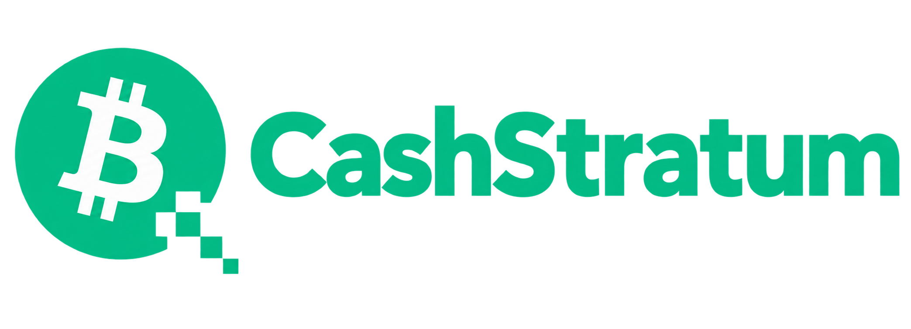</a>

# Mining infrastructure for Bitcoin Cash

**An open-source Stratum server and solo pool engine, built on CKPool.**

Run your pool. Choose direct payouts or username-based mining. Inspect the work all the way to the block.

<picture>
  <source media="(prefers-color-scheme: dark)" srcset=".github/assets/readme/hero-dark.webp">
  <source media="(prefers-color-scheme: light)" srcset=".github/assets/readme/hero-light.webp">
  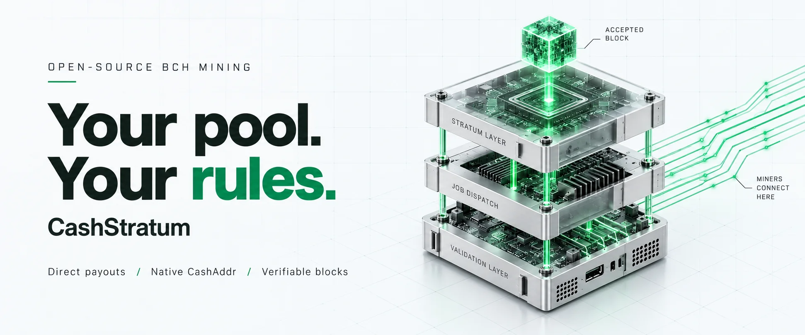
</picture>

[](https://github.com/cashstratum/cashstratum/releases/tag/v1.4.0)
[](docs/proofs/)
[](#release-validation)
[](COPYING)

**[Get started](#get-started)** · **[Explore the features](#the-cashstratum-advantage)** · **[Choose your node](#choose-your-node)** · **[Verify the blocks](#production-proof)**

[Releases](https://github.com/cashstratum/cashstratum/releases) · [Documentation](#documentation) · [Contribute](CONTRIBUTING.md) · [cashstratum.com](https://cashstratum.com)

| BCH mainnet blocks | Gross block rewards | Historical value (81-block collection) | On the released build |
|:---:|:---:|:---:|:---:|
| **[98](docs/proofs/)** | **[306.45989629 BCH](docs/proofs/)** | **[≈ $132,752.44](docs/proofs/VALUATION.md)** | **[21 blocks on v1.2.1, 1 on v1.3.0](#production-proof)** |
| Every hash checked on chain | Includes transaction fees | 72 saved + 2 screenshots + 7 fallbacks | 2026-10-06 → 2026-10-31 |

Proof snapshot: **2026-10-12 UTC**. [Methodology and limitations](#production-proof).

</div>

## See a real block land

<picture>
  <source media="(prefers-color-scheme: dark)" srcset=".github/assets/readme/block-accepted-dark.svg">
  <source media="(prefers-color-scheme: light)" srcset=".github/assets/readme/block-accepted-light.svg">
  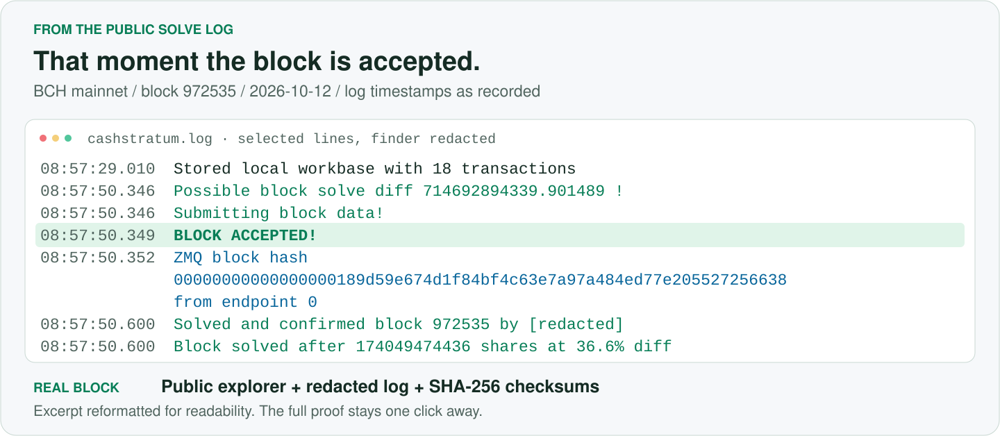
</picture>

**Block [972535](https://www.blockchain.com/explorer/blocks/bch/972535)** — the candidate,
submission, `BLOCK ACCEPTED!`, ZMQ notification and confirmation, from the same solve.
This is a typeset excerpt of the [public redacted log](docs/proofs/logs/972535-context.log),
with the date shown once and long lines wrapped. It is historical evidence, not live telemetry.
The [proof index](docs/proofs/) contains the full hash, explorer link and excerpt checksum.

## Get started

Clone a release on Linux, then run the guided installer:

```bash
git clone --branch v1.4.0 --depth 1 https://github.com/cashstratum/cashstratum.git
cd cashstratum
bash install-cashstratum.sh
```

**A guided setup, with your choices.** The installer prompts for the installation directory,
node RPC credentials and operator BCH address. Review the
[prerequisites and guided installation steps](docs/installation.md#interactive-installation-from-a-checkout)
first. For a managed BCHN service with node and address validation, use the
[solo installer](docs/installation.md#solo-pool); it also supports staging and `--no-start`
so you can inspect the setup before activation.

**[Install a solo pool →](docs/installation.md)** · [Configure payouts](README-SOLOMINING.md) · [Read the operator API guide](docs/operator-api.md)

You need Linux and an existing, synced BCH full node. The solo installer supports **BCHN**;
**BCHD** and **Flowee the Hub** use manual configuration. The installers serve **Stratum V1**;
they do not provision a node or automatically enable SV2.

### Release status

**[v1.4.0](https://github.com/cashstratum/cashstratum/releases/tag/v1.4.0)** (2026-11-01) drops block-sized round bests left on disk by earlier releases and makes `cashtop` label what the daemon counts (idle workers, zmq state, pool counts, odds basis); the stratum server changed, so pools rebuild and restart.
**v1.3.1** added `cashtop`, a read-only terminal dashboard, and left the stratum server unchanged from v1.3.0.
**v1.3.0** added per-user and per-worker reject statistics, capped the difficulty credited to
rejected shares, recorded a reason for every disconnect, and shipped a filtered `monitor.sh`. **v1.2.5** fixed the Stratum V2
Noise certificate version and **v1.2.2** introduced BCHD and Flowee compatibility. See
[CHANGELOG.md](CHANGELOG.md) for release details and
deployment evidence. This tree includes the C engine, Go services, installers, unit tests
and the regtest mining gate.

### Release validation

**Tested in development. Published after validation.** Before every engine release, we run
regtest and testnet checks in the development repository. Only after those checks are
complete do we publish the tested release here. Documentation and proof releases, such as
this one, leave the engine unchanged and pass the public build, unit-test and regtest gate.

Regtest exercises real block submission, coinbase payouts, address handling and independent
miner rounds. Testnet checks cover network compatibility, work templates and accepted shares.
The public release gate also runs the Linux build, unit tests, Go API tests and regtest mining.
[See the release checks](https://github.com/cashstratum/cashstratum/actions/workflows/release-gate.yml)
and [detailed chain coverage](README-CASHSTRATUM.md#what-has-actually-been-proven-and-on-which-chain).

## The CashStratum advantage

<picture>
  <source media="(max-width: 600px) and (prefers-color-scheme: dark)" srcset=".github/assets/readme/feature-showcase-mobile-dark.svg">
  <source media="(max-width: 600px) and (prefers-color-scheme: light)" srcset=".github/assets/readme/feature-showcase-mobile-light.svg">
  <source media="(prefers-color-scheme: dark)" srcset=".github/assets/readme/feature-showcase-dark.svg">
  <source media="(prefers-color-scheme: light)" srcset=".github/assets/readme/feature-showcase-light.svg">
  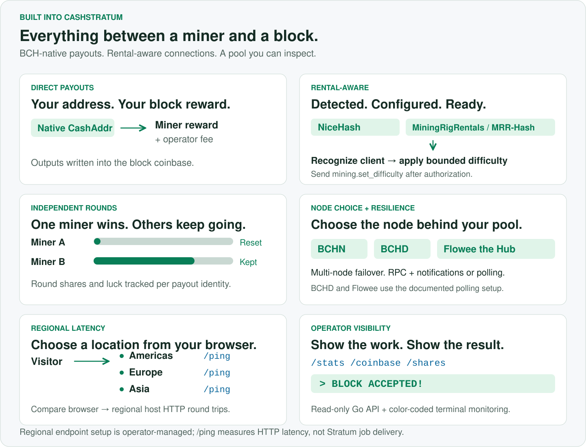
</picture>

<details>
<summary><strong>Read the complete feature descriptions</strong></summary>


| Capability | What it provides |
|---|---|
| **Native CashAddr** | BCH address parsing and payout-script construction, with network and checksum validation. |
| **Direct solo payouts** | In per-address solo mode, the winning miner's address receives its share of the reward in the block's coinbase transaction. |
| **Operator fee** | A configurable fee output alongside the miner's payout. |
| **Per-address rounds** | Separate round-share and luck statistics for each payout identity; one miner's solve does not reset everyone else's round. |
| **Rental compatibility** | Recognizes NiceHash, MiningRigRentals and MRR-Hash client identifiers, applies the configured rental difficulty and sends it immediately after authorization. Operator bounds still apply. |
| **Node choice and resilience** | [BCHN, BCHD or Flowee the Hub](#choose-your-node); multi-node RPC, ZMQ where configured, polling and failover handling. |
| **Go operator API** | Read-only access to pool statistics, miner records, shares, coinbase details and block-find logs. |
| **Browser latency probe** | Expose `/ping` at each regional pool host so visitors can compare browser-to-region HTTP round-trip times and choose a location. |
| **Terminal monitoring** | [`cashtop`](#cashtop-a-terminal-dashboard-for-your-pool), a read-only dashboard for the pool host, plus the zero-dependency [`monitor.sh`](monitor.sh) log view. |

The API's latency probe measures the HTTP path. It is not a measurement of Stratum job-delivery
latency, ASIC performance or block-propagation speed.

</details>

Rental clients receive the configured difficulty immediately after authorization. Regional
`/ping` endpoints measure browser-to-host HTTP round trips; operators supply the regional
deployment and comparison interface. See the [API guide](docs/operator-api.md).

## cashtop: a terminal dashboard for your pool

`cashtop` runs on the pool host over SSH and reads the pool's own files and the node's read-only
RPC. It never writes inside the pool install and never calls a mutating RPC method. The installer
builds it on the host when Go is available and puts it on `PATH`, so you just run `cashtop`.

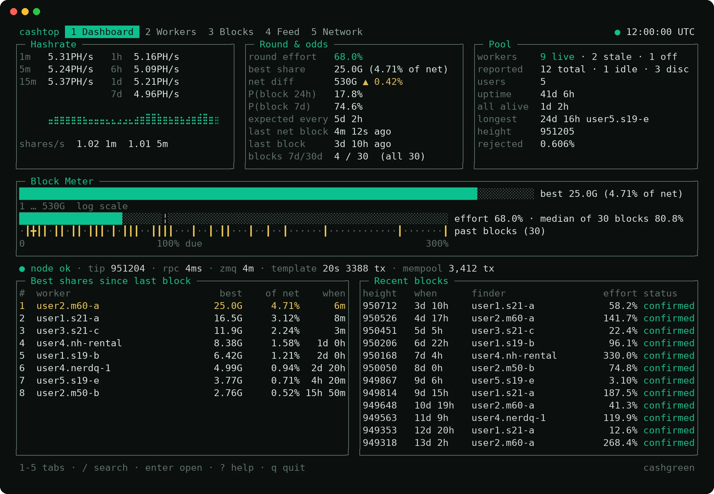

- **Dashboard.** Pool hashrate, round effort and odds, time since the last network block, and the
  difficulty change. The Block Meter shows the best share against network difficulty, with the
  round effort measured against past blocks.
- **Workers and addresses.** Rig types, live and stale state, and per-address round work. Each
  share is listed with its difficulty against the network.
- **Blocks.** Block history with effort, confirmations and reward. Enter on a block opens the
  sharelog for that height, with the winning share highlighted.
- **Feed.** The filtering rules of `monitor.sh`, in a scrollable pane.
- **Block found.** A full-screen celebration, the terminal bell and desktop notifications where
  the terminal supports them. `--quiet` turns it off.

<table>
  <tr>
    <td>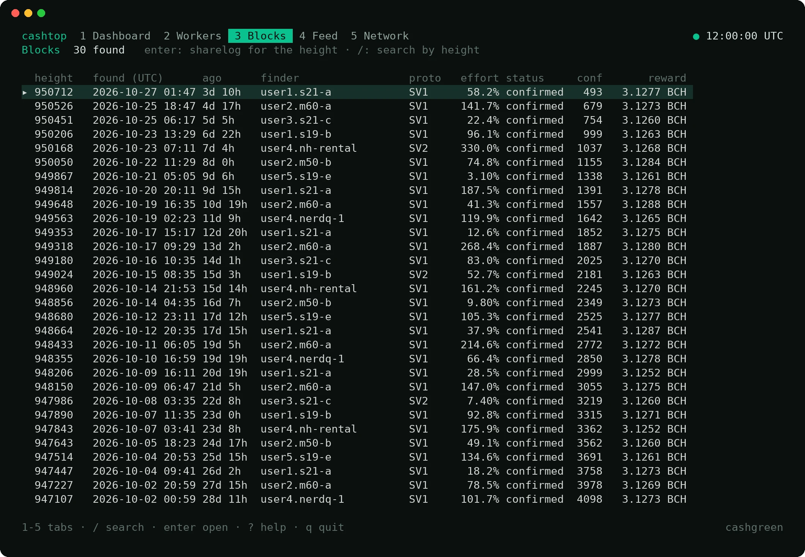</td>
    <td>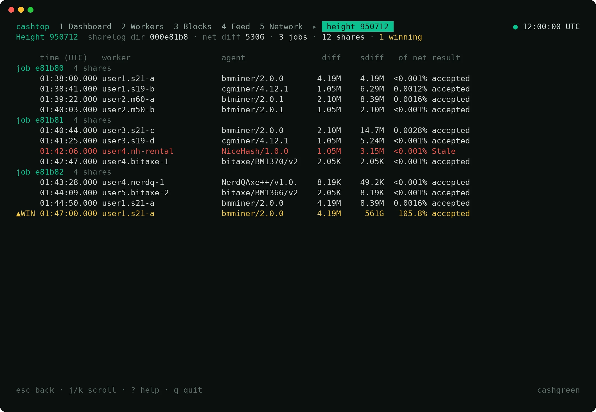</td>
  </tr>
  <tr>
    <td>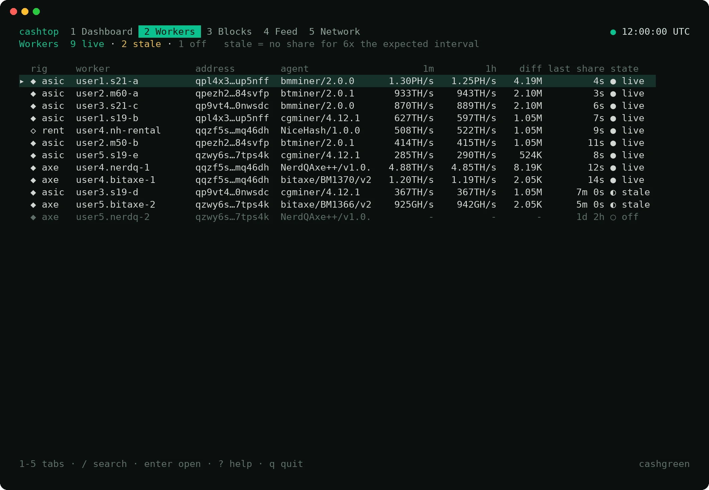</td>
    <td>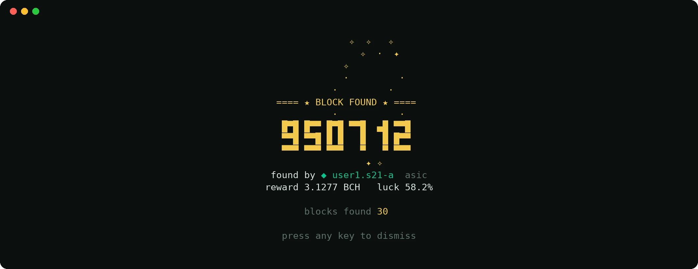</td>
  </tr>
</table>

Screenshots use `cashtop --demo=showcase`, which generates synthetic data. Try it without a pool:
`cd api && go run ./cmd/cashtop --demo=showcase`.

## Choose your node

<table>
  <tr>
    <td align="center" width="33%">
        <picture>
          <source media="(prefers-color-scheme: dark)" srcset=".github/assets/readme/bchn-dark.svg">
          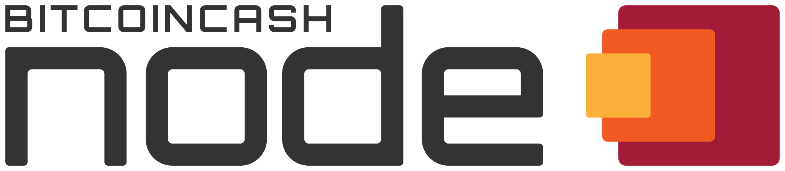
        </picture>
      <br>
      <strong><a href="https://bitcoincashnode.org/">Bitcoin Cash Node</a></strong><br>
      Reference node<br>
      RPC + ZMQ notifications<br>
      Solo installer + regtest gate
    </td>
    <td align="center" width="33%">
      <a href="https://bchd.cash/"></a><br>
      <strong><a href="https://github.com/gcash/bchd">BCHD</a></strong><br>
      Supported since v1.2.2<br>
      RPC + block polling<br>
      Manual configuration
    </td>
    <td align="center" width="33%">
      <a href="https://flowee.org/products/hub/"></a><br>
      <strong><a href="https://flowee.org/products/hub/">Flowee the Hub</a></strong><br>
      Supported since v1.2.2<br>
      RPC + block polling<br>
      Manual configuration
    </td>
  </tr>
</table>

**[Node-specific setup →](docs/installation.md#supported-nodes)**

BCHN is the reference node for the installer and end-to-end mining gate. BCHD and Flowee
are supported through RPC adaptation and polling; **CashStratum did not add ZMQ to BCHD**.
See the node guide for configuration requirements and
[v1.2.2](https://github.com/cashstratum/cashstratum/releases/tag/v1.2.2) for the integration
contributed by [@CyberAshven](https://github.com/CyberAshven).

**Purpose-built for Bitcoin Cash.** Infrastructure that tries to serve every chain rarely excels
at any single one. CashStratum focuses exclusively on Bitcoin Cash — its CashAddr format, its
non-SegWit block structure, its node implementations (`BCHN`, `BCHD`, and `Flowee the Hub`), and
its mainnet, testnet and regtest networks — so every path from miner login to block submission is
engineered and verified for BCH. Operators targeting Bitcoin (BTC) should use upstream CKPool.


## Choose your mining model

The pool owner chooses how miners connect and receive rewards:

| Miner login | Reward destination in per-address solo mode |
|---|---|
| **BCH CashAddr**, optionally with a worker suffix | The winning miner's address, less the configured operator fee, directly in the block coinbase |
| **Plain username**, optionally with a worker suffix | The pool's configured `bchaddress`; the operator supplies account balances and miner payouts |

Address-shaped logins with an invalid checksum or wrong network are rejected. Coinbase
maturity applies. [Payout behavior and configuration](README-CASHSTRATUM.md#smart-fallback--typo-protection).

**Open access or private operation.** Address-based solo mining can be account-free and
pseudonymous. For a private pool, restrict access with your network, VPN or firewall and
protect the operator API. On-chain payouts remain public.
[Solo mining](README-SOLOMINING.md) · [Installation and access boundaries](docs/installation.md).


## C engine, Go API, shell tooling

<picture>
  <source media="(prefers-color-scheme: dark)" srcset=".github/assets/readme/architecture-dark.svg">
  <source media="(prefers-color-scheme: light)" srcset=".github/assets/readme/architecture-light.svg">
  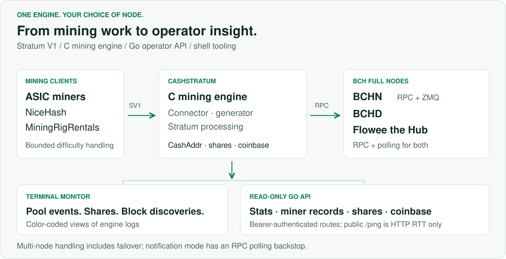
</picture>

The mining engine retains CKPool's C foundation and cooperating connector, generator and
Stratum-processing components. The Go API supplies operator-facing read access; it does not
replace the mining engine. Shell tools support installation and terminal monitoring.

Authenticated API routes expose operational data. The lightweight `/ping` route is deliberately
unauthenticated and separately rate-limited. The full endpoint reference, configuration table and
deployment procedure — including network boundaries and TLS — are documented in
**[docs/operator-api.md](docs/operator-api.md)** and summarized below.

The installer uses `cashstratum`, `cashstratum.conf`, `cashstratum.service` and
`cashstratum.log`. Source builds retain `src/ckpool`; pass `-n cashstratum` explicitly
when launching it. See the [installation guide](docs/installation.md) before migrating an existing pool.

## Build on the operator API

The read-only Go API supplies pool stats, miner records, resumable shares, decoded coinbase
outputs and block-find logs. The optional notifier delivers signed block events to your
application. Use them to build dashboards, transparency views and notifications around the
mining engine.

API routes require bearer authentication except for the separately rate-limited `/ping`
probe. See the [endpoint reference, deployment and TLS guide](docs/operator-api.md) and
[block notifier](docs/operator-api.md#block-notifier-optional-companion).

### See a reference deployment

[BlockSniper.ai](https://blocksniper.ai) runs CashStratum with its own website: auditable
candidate payouts, readable block history, in-page alerts and Telegram rental controls.
Those interfaces and rental automations are application integrations built around the engine.
Other operators can build their own branded experience.

**[Explore CashStratum](https://cashstratum.com)** · **[Visit the reference pool](https://blocksniper.ai)**


## Production proof

**98 BCH mainnet blocks from this engine's lineage, every one verified against public chain
data** — from the EloPool deployment in 2025 to the released CashStratum build today. The
81-block collection is fixed; the 17 blocks found since it are kept in a separate file.

| Era | Software | Blocks | Dates (UTC) | Gross BCH | Solve excerpts |
|---|---|---:|---|---:|---:|
| **EloPool** | modified CKPool fork | 68 | 2025-07-15 → 2025-12-06 | 212.67746187 | 35 |
| **BlockSniper** | modified CKPool fork | 1 | 2026-09-01 | 3.12542747 | 1 |
| **CashStratum** | **release v1.2.1** | **12** | **2026-10-06 → 2026-10-12** | **37.51657353** | **12** |
| | | **81** | | **253.31946287** | **48** |
| **CashStratum**, since the collection | **release v1.2.5** (7), **release v1.2.1** (2) | **9** | **2026-10-12 → 2026-10-23** | **28.13832975** | **9** |
| **CashStratum**, since the collection | **release v1.2.1** | **7** | **2026-10-27 → 2026-10-29** | **21.87680497** | **7** |
| **CashStratum**, since the collection | **release v1.3.0** | **1** | **2026-10-31** | **3.12529870** | **1** |
| | | **98** | | **306.45989629** | **65** |

**The 12 blocks of October 2026 are the first found by a tagged CashStratum release**, running
on the reference deployment: heights
[971726](https://www.blockchain.com/explorer/blocks/bch/971726),
[971744](https://www.blockchain.com/explorer/blocks/bch/971744),
[971770](https://www.blockchain.com/explorer/blocks/bch/971770),
[971817](https://www.blockchain.com/explorer/blocks/bch/971817),
[971860](https://www.blockchain.com/explorer/blocks/bch/971860),
[972310](https://www.blockchain.com/explorer/blocks/bch/972310),
[972313](https://www.blockchain.com/explorer/blocks/bch/972313),
[972318](https://www.blockchain.com/explorer/blocks/bch/972318),
[972517](https://www.blockchain.com/explorer/blocks/bch/972517),
[972524](https://www.blockchain.com/explorer/blocks/bch/972524),
[972529](https://www.blockchain.com/explorer/blocks/bch/972529) and
[972535](https://www.blockchain.com/explorer/blocks/bch/972535). Each has a redacted solve log
showing the candidate, the submission, `BLOCK ACCEPTED!` and the ZMQ tip change, with SHA-256
checksums for the excerpt and its source.

**17 more blocks have been found since the collection**, heights 972548 → 975301
(2026-10-12 → 2026-10-31): seven on release v1.2.5, nine on release v1.2.1 and one on release
v1.3.0, for **21 blocks on v1.2.1** in total. They are listed with their
redacted solve excerpts in [`recent-blocks.json`](docs/proofs/recent-blocks.json); see the
[proof index](docs/proofs/#17-additional-blocks-since-this-collection).

Every record in the **[proof index](docs/proofs/)** carries the height, hash, UTC block date,
coinbase transaction and script, recognised coinbase tag and verification time, plus an
explorer link. For the 81-block collection, the **[valuation](docs/proofs/VALUATION.md)** prices each block's gross coinbase
reward using its saved BlockSniper price: **72 database snapshots, two separately marked
BlockSniper screenshot prices, and 7 historical Coinbase fallbacks**. The independent Coinbase/Bitstamp calculation is retained
for comparison. No current-price repricing is used.

> **What this proves, and what it does not.** It proves the blocks exist on the BCH main chain
> and carry this deployment's coinbase tags, and that solve-time logs exist for 65 of them. A
> coinbase tag is self-declared: it does not cryptographically attest a software build. The
> `software` field on the CashStratum-era records comes from the operator's deployment record.
> None of this establishes hashrate, luck, or a performance advantage over other engines.

CashStratum is the software. BlockSniper is a reference deployment. Other operators can run
the engine under their own pool name and branding.

### Verify it yourself

Everything needed is in [`docs/proofs/`](docs/proofs/), and every script uses only the Python 3
standard library:

```bash
git clone https://github.com/cashstratum/cashstratum && cd cashstratum/docs/proofs

python3 verify.py --offline   # record structure + SHA-256 of every solve excerpt
python3 verify.py             # re-fetch all 81 collection blocks and coinbases from a public BCH API
python3 verify-recent.py      # re-fetch the 17 blocks found since the collection
python3 verify-values.py      # re-do every reward sum and price-boundary check (offline)
```

`verify.py` requires each stored hash to be on the main chain at its height, the first
transaction to be a coinbase with the recorded script, and every excerpt to match its checksum.
`verify-values.py` checks both valuation methods, including saved-price arithmetic and totals.
For the independent exchange method, every candle must close **before** the block's header time. Prefer an explorer?
[blocks.csv](docs/proofs/blocks.csv) links every block.

## Have us build your pool

Want a public pool under your brand or a private setup for your rigs? We can help with
installation, supported nodes, payout configuration, monitoring and a custom miner-facing
experience. Professional setup is optional; CashStratum remains open-source and self-hostable.

**[Inquire at cashstratum.com →](https://cashstratum.com)**


## Documentation

| I want to… | Read |
|---|---|
| Install and run a pool | [Installing CashStratum](docs/installation.md) — prerequisites, staged install, [supported nodes](docs/installation.md#supported-nodes) |
| Configure solo mining and addresses | [Configuration guide](README-CASHSTRATUM.md) · [Solo mining](README-SOLOMINING.md) · [Pool fee](POOL_FEE.md) |
| Understand the modes | [CashStratum modes](README-CS_MODES.md) · [Proxy mode](README-CSPROXY.md) |
| Harden a deployment | [Security hardening](docs/security-hardening.md) · [Security notes](README-SECURITY.md) · [Share-inflation analysis](SECURITY-share-inflation.md) |
| Read pool data from a dashboard | [Operator API](docs/operator-api.md) · [API guide](CASHSTRATUM_API_GUIDE.md) |
| Check the production evidence | [Proof index](docs/proofs/) · [Valuation](docs/proofs/VALUATION.md) · [Verify it yourself](#verify-it-yourself) |
| See what changed | [CHANGELOG](CHANGELOG.md) · [Releases](https://github.com/cashstratum/cashstratum/releases) |
| Report a vulnerability | [SECURITY.md](SECURITY.md) — privately, please |

## Join the project

We welcome reproducible bug reports, payout and address-validation regression cases, ASIC and
rental compatibility reports, documentation improvements, and performance measurements with
commands and hardware details.

- Read [CONTRIBUTING.md](CONTRIBUTING.md) before opening a pull request.
- Follow [SECURITY.md](SECURITY.md) for privately reporting security issues.
- To propose a pool listing, use the [Add your pool](https://github.com/cashstratum/cashstratum/issues/new?template=add-your-pool.yml) issue template. Listings require verification.

## License and acknowledgments

Node logo sources and visual notes: [asset reference](.github/assets/readme/SOURCES.md).

**GNU GPL version 3 or later** — see [COPYING](COPYING).

CashStratum is derived from **CKPool by Con Kolivas and its contributors**. Their work remains
an essential part of this engine. BCH development originated in the BlockSniper / EloPool fork
and continues here with community contributions. Original copyright and license notices are
retained; the CashStratum name identifies this project's maintenance and BCH direction.
